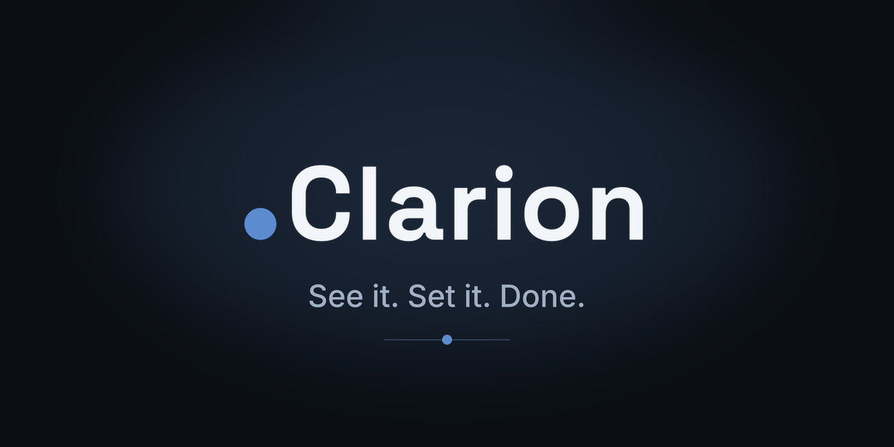
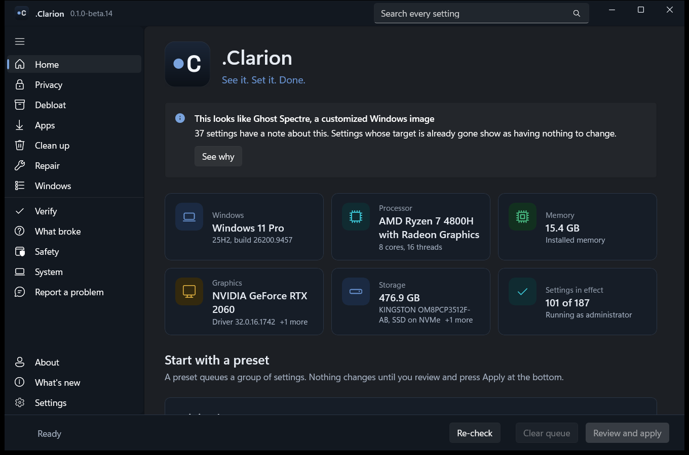
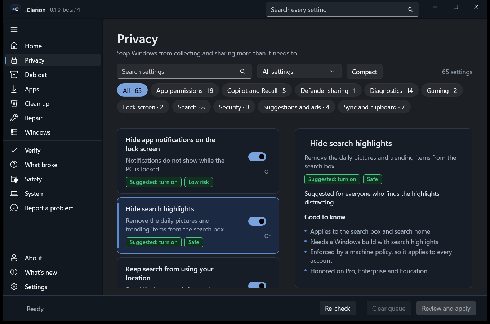
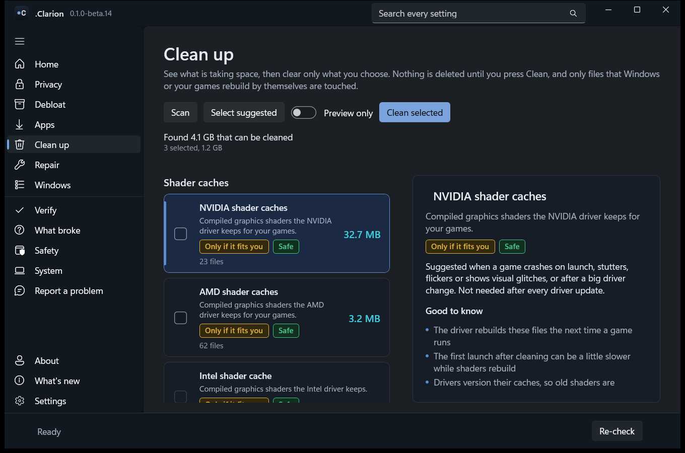
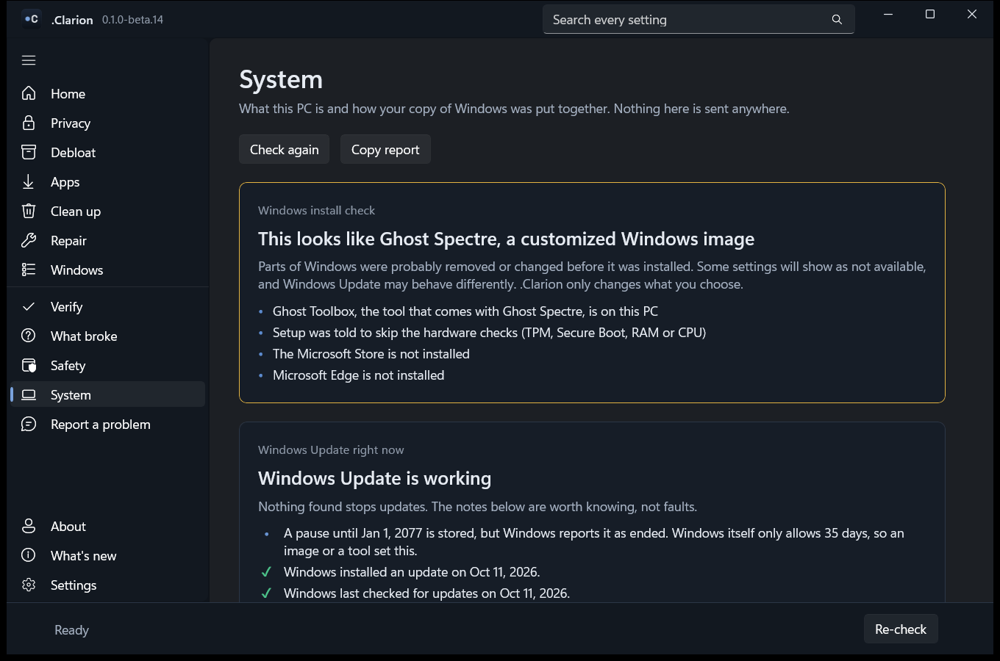

<div align="center">



A native Windows app to remove bloat, cut tracking, clean up, repair and tune your PC.
Every change is explained, graded by evidence, backed up and reversible.

[](https://github.com/Kkthnx/Clarion/releases)
[](https://github.com/Kkthnx/Clarion/releases)


[**Download**](https://github.com/Kkthnx/Clarion/releases/latest) | [Every setting explained](https://kkthnx.github.io/Clarion/) | [Report a problem](https://github.com/Kkthnx/Clarion/issues/new/choose) | [Changelog](CHANGELOG.md)

</div>

> **Version 1.0, not code signed.** .Clarion is out of beta, but the downloads carry no code signing certificate, so Windows SmartScreen warns on first run (see below and [docs/SIGNING.md](docs/SIGNING.md)). Every setting was checked on one PC running Windows 11 build 26200, so please report anything that behaves differently on yours.



## Why .Clarion

- **Every setting explained.** Hover any setting for what it does, what you gain, what could go wrong and whether it is suggested. No research needed.
- **Evidence graded.** Each setting says how well it is backed, and privacy settings carry the Windows policy they come from, checked against the policy files on your PC.
- **Safe by design.** A restore point before every batch, a journal that records the real previous value, and one click revert.
- **Honest.** No telemetry in the app and no account. .Clarion's own only request is an update check, and that is off unless you ask for it. The Apps page runs winget, Microsoft's package manager, which talks to Microsoft's package source and the publishers' download sites, and it does so only when you open that page or install an app. Weak or unproven tweaks are hidden unless you turn on Expert mode.



## What it does

| | |
|---|---|
| **Privacy and debloat** | 216 settings across privacy, app removal, tweaks, power, network, Windows features and updates. A Compact switch fits about three times as many on screen, and topic pills narrow a long list in one click. |
| **Apps** | 135 programs installed with winget, each one an exact package. The review shows the publisher, licence, installer host and checksum, and nothing installs until you accept the licence terms. Revert uninstalls. |
| **Clean up** | Shader caches, launcher caches, browser and Windows leftovers. Scans first, shows exact folders and sizes, skips files in use and queues locked files for the next restart. |
| **Repair** | System file check, component repair, network and update resets. Output streams live and any job can be stopped. |
| **Presets** | Minimal, Standard, Advanced, Gaming and Privacy. Each lists the settings it holds and marks the ones already on. Queue one, review it, apply it. |
| **DNS** | Pick a public provider from a dropdown, with optional encrypted lookups, or press a button to time each one from your PC and see which is nearest. Revert restores exactly what you had. |
| **Home** | Windows, processor, memory, graphics, storage and how many settings are in effect, at a glance. |
| **System** | Windows edition, build, hardware and security state, plus a check for customized Windows images (it names Ghost Spectre and can guess tiny11, and explains every sign it finds) and a "Windows Update right now" card that says whether updates are working, limited or held back and why. Settings that depend on something the image removed carry a note. |
| **Services** | A read only list of every Windows service on this PC beside Microsoft's table of default start types and recommendations, with what is running, how much memory it uses, and a link to the .Clarion setting where there is one. It never changes a service, and says plainly that a difference from the table is not proof that anyone changed it. |
| **Verify** | Checks everything .Clarion applied against Windows now. Lists removed apps that came back and settings that were changed back, usually after a feature update. Put them back in one step, or leave them as they are. |
| **What's new** | What changed in each version, grouped as New, Safer, Fixed and Polish. When a newer version exists it lists everything you missed and links to the release page. .Clarion never downloads or installs the update itself. |
| **Monthly check** | Optional. A scheduled task checks the settings .Clarion applied on the second Wednesday of each month, the day after Windows' monthly updates, and tells you the next time you open .Clarion what changed back. |
| **What broke** | Pick what stopped working and see which of your changes could explain it, newest first, with a revert button on each. |
| **Live progress** | A panel with a progress bar and one line per setting while changes apply. A Stop button ends the run before the next setting, never in the middle of one. |
| **Safety** | Lists the restore points Windows has and can make one on demand. Revert one setting, everything, or everything changed after a day you pick. You review the revert before anything changes. |
| **Report a problem** | Builds a bug report or suggestion with your system details and recent activity, with names, addresses and accounts removed. You can also add how your settings are holding up, which helps keep the "last checked" labels honest. You read it, then open it on GitHub yourself. |
| **Setup files and command line** | Save your choices to a file and apply them on another PC, or run everything from a terminal. |





## Install

1. Download `Clarion-<version>-setup.exe` from the [latest release](https://github.com/Kkthnx/Clarion/releases/latest). A portable zip is there too.
2. Run it. .Clarion installs to Program Files with a Start menu entry and a clean uninstaller.
3. Open .Clarion. It asks for administrator rights when it opens, because most settings are machine wide. If you say no, it opens in a read only mode that can look and verify but changes nothing, with a button to restart as administrator.

The files are not code signed yet, so Windows SmartScreen shows its "Windows protected your PC" screen on first run, with Don't run as the default, and the administrator prompt names the publisher as Unknown. Choose More info, then Run anyway if you trust this download. Signing is still wanted, and the options and their costs are in [docs/SIGNING.md](docs/SIGNING.md). Each download has a SHA256 file next to it so you can verify it. From 0.1.0-beta.16 each one also has a build attestation from GitHub, a signed statement that GitHub built that exact file from this repository. Check it with `gh attestation verify <file> --repo Kkthnx/Clarion`. Windows does not read it, so SmartScreen still warns.

Requirements: Windows 10 version 2004 or later, 64-bit. Nothing else needs installing, because the .NET runtime is included. The one exception is the Apps page, which needs winget, Microsoft's package manager. It comes with App Installer on Windows 11 and on current Windows 10. .Clarion does not install it, and without it the apps are shown as unavailable.

### How the apps are chosen

Every app is one exact winget package ID, never a search, and was checked before it went in: its winget record was read for the publisher, licence and installer host, and its installer manifest was read for settings that stop an administrator install. An app whose installer refuses to run as administrator is left out. Apps known to bundle offers in their installers were not added, though that was a judgement made while choosing and is not a check the build repeats. Where a record needs an install folder, the catalog carries it. The list is a short selection of well known apps, not everything winget has.

## Command line

```
Clarion.exe --version
Clarion.exe --list-presets
Clarion.exe --apply-preset standard [--preview] [--no-restore-point]
Clarion.exe --apply setup.json [--preview] [--no-restore-point] [--accept-package-agreements]
Clarion.exe --clean [--only a,b] [--include c,d] [--preview]
Clarion.exe --verify [--save]
Clarion.exe --what-broke symptom [--since 2026-09-01]
Clarion.exe --history
Clarion.exe --list-presets | --list-settings | --list-cleanups | --list-symptoms
```

`--preview` shows what would change and changes nothing. Apps in a setup are skipped unless you add `--accept-package-agreements`, which says you accept the publishers' licence terms. `--verify`, `--what-broke`, `--history` and the list commands only read, and start without administrator rights. Exit codes: 0 success, 1 some steps failed, 2 bad arguments or file, 3 not elevated.

## Build from source

Needs the .NET 9 SDK and the Windows 11 SDK.

```
dotnet test
dotnet build src/Clarion.App -p:Platform=x64
```

To build the installer and zip, install Inno Setup 6 and run `scripts/build-installer.ps1`.

## Docs

- [Design and approach](docs/DESIGN.md)
- [Feature matrix](docs/FEATURES.md)
- [Every setting explained, as a website](https://kkthnx.github.io/Clarion/)
- [Every setting, written out as one page](docs/CATALOG.md)
- [Brand and palette](docs/BRAND.md)
- [Changelog](CHANGELOG.md)
- [Versioning](docs/VERSIONING.md)
- [Contributing](CONTRIBUTING.md)
- [Code signing plan](docs/SIGNING.md)
- [License](LICENSE)

## Principles

- Explain every change in plain language, with benefit and risk.
- Restore point before every batch, and a journal that restores the real prior value.
- Never weaken security.
- No telemetry in the app itself.

## License

All rights reserved. The source is public so you can read it and check what .Clarion does, but it is not open source and you may not reuse or redistribute it. You are welcome to run the releases and to report problems. The full terms are in [LICENSE](LICENSE).
